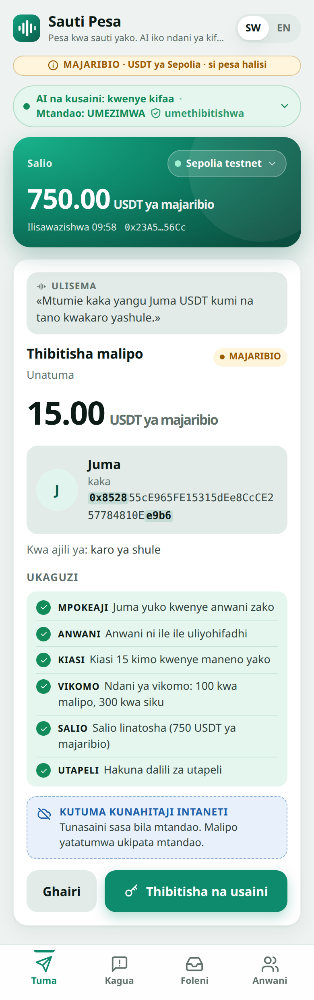
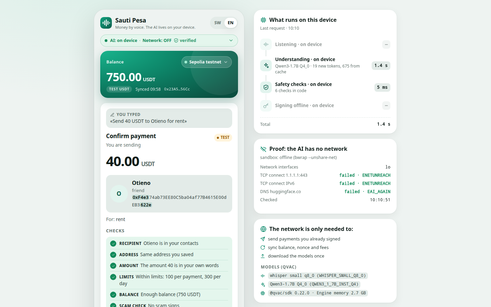
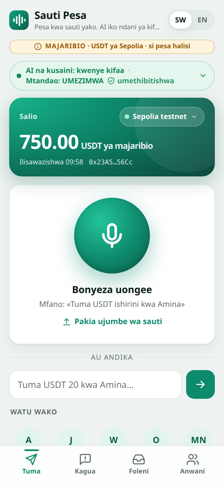
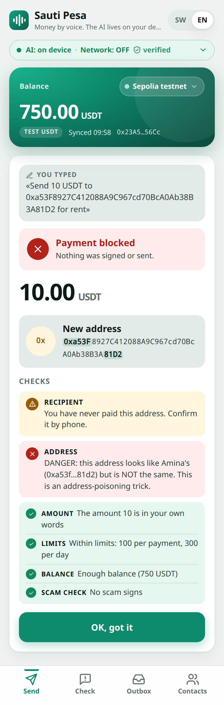
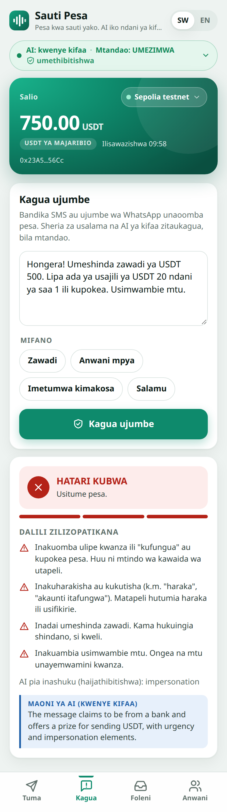
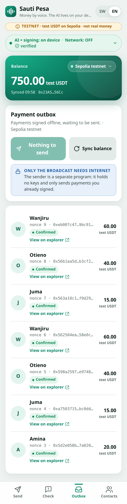
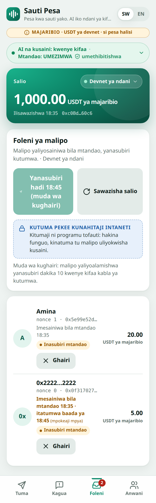
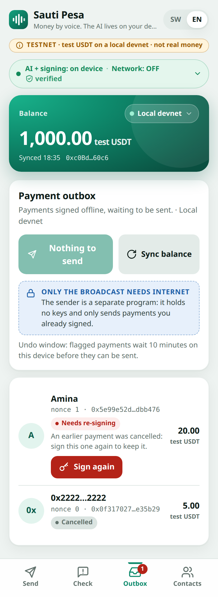
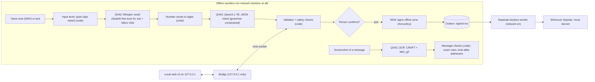

# Sauti Pesa

> **Judges: [JUDGES.md](JUDGES.md)** is one page with the offline run (5 commands, expected output), where QVAC and
> WDK are called, what needs the internet and how "off" is enforced, known limits, and where each form answer is.

**USDT next to M-Pesa, in Swahili, offline, with a second pair of eyes for the fake "send it back" messages.**
Many people in East Africa keep savings and receive money in USDT next to M-Pesa, and the scams arrive in Swahili:
a fake M-Pesa "confirmation", then *"nimekutumia pesa kimakosa, nirudishie"* ("I sent you money by mistake, send it
back"). With Sauti Pesa you say or type *"Tuma USDT ishirini kwa Amina"*, or pick a screenshot of a message you are
not sure about. The AI runs **on your own device** with [QVAC](https://docs.qvac.tether.io): Whisper for speech (a Swahili
fine-tune for Swahili), Qwen3-1.7B for intent, OCR for screenshots. Plain code then checks the payment or the message, and
[WDK](https://docs.wdk.tether.io) signs **offline**. Signed payments wait in an outbox until there is a network.
The whole app passes its end-to-end tests under a hard [3 GB memory cap](#runs-in-3-gb) (measured on an ARM64 Linux box, not a phone).

Track: **Agentic finance with WDK** · AI Yako: Own Your AI (Tether QVAC) · built by Swift Bot Labs

<p>
  
  &nbsp;
  
</p>

<details>
<summary>More screens (390 px): home, look-alike address blocked, message check, outbox, undo window</summary>
<p>
  
  
  
  
  
  
</p>
</details>


**Trailer (0:56): [sauti-pesa-trailer.mp4](https://github.com/swiftbotlab/sauti-pesa/releases/download/v1.3/sauti-pesa-trailer.mp4)** · a Swahili "send it back" scam caught offline, a spoken Swahili payment checked and signed on the device, and only the broadcast online. Cut from the same real recordings at real speed; test USDT on Sepolia.

**Demo video (internet off): [sauti-pesa-demo-v1.2.mp4](https://github.com/swiftbotlab/sauti-pesa/releases/download/v1.2/sauti-pesa-demo-v1.2.mp4)** · captions ([.srt](https://github.com/swiftbotlab/sauti-pesa/releases/download/v1.2/sauti-pesa-demo-v1.2.srt)) + English voice-over, 3:05.
The same recording as the [original cut](https://github.com/swiftbotlab/sauti-pesa/releases/download/v1.0/sauti-pesa-demo.mp4) (2:57 + a 5 s offline-proof card), with a
test-token label on screen the whole time and a 3 s opening card that says what is tested.
Recorded before the final hardening pass. Since then `ops/ui.sh` prints a link that carries a per-launch key, and
the page needs that link; the payment flows in the video behave the same.

> [!NOTE]
> **Test money only.** Every USDT amount in the app, the video and the transaction table below is a **test token
> worth nothing**, not Tether's USDT: on Sepolia the 6-decimal test USDT
> [`0xaA8E23Fb1079EA71e0a56F48a2aA51851D8433D0`](https://eth-sepolia.blockscout.com/token/0xaA8E23Fb1079EA71e0a56F48a2aA51851D8433D0)
> (listed in the WDK docs for testnets), on the local devnet our own [`contracts/MockUSDT.sol`](contracts/MockUSDT.sol).
> The app labels every amount "test USDT" and shows a "TESTNET · not real money" badge.
> **Offline vs online:** speech to text, intent, the scam and safety checks and the signing all run **offline** on
> the device. Only the broadcast of payments that are already signed needs the internet.

**Supplementary 1-min clip: [check a scam screenshot offline](https://github.com/swiftbotlab/sauti-pesa/releases/download/v1.1/sauti-pesa-screenshot-check.mp4)** · QVAC OCR on the device, three Swahili test screenshots (two scams, one with a look-alike address, and one genuine message), English captions, 1:08.

**Evidence:** [QVAC profiler run](evidence/README.md) (one offline run: load and unload, time to first token, tokens/s and memory for Whisper + VAD, Qwen3-1.7B and OCR; [`qvac-profile.json`](evidence/qvac-profile.json)) · [Swahili speech model comparison](evidence/README.md#evidence-swahili-speech-model-2026-10-28) (multilingual Whisper small vs a Swahili fine-tune: WER 78.3% → 20.1% on 40 real voices; [`asr-swahili-finetune.json`](evidence/asr-swahili-finetune.json)) · [Remote APIs](REMOTE_APIS.md) (every endpoint the code can contact; the AI path contacts none).

> [!IMPORTANT]
> Testnets only. There is no mainnet configuration in the code (`src/networks.js`). Use a fresh test wallet.

## Contents
- **[JUDGES.md](JUDGES.md): run it offline in 5 commands**
- [Why](#why) · [What it does](#what-it-does) · [How it works](#how-it-works) · [Offline vs network](#offline-vs-network)
- [QVAC integration](#qvac-integration) · [WDK integration](#wdk-integration) · [Safety checks](#safety-checks) · [Undo window](#undo-window) · [Security model](#security-model)
- [Run it](#run-it) · [Measurements](#measurements) · [Real voices](#real-voices-fleurs-swahili-native-speakers) · [Runs in 3 GB](#runs-in-3-gb) · [Limitations](#limitations) · [Built during the event](#built-during-the-event-and-third-party-work)

## Why
Many people in East Africa now keep savings and receive remittances in USDT, next to M-Pesa. Three problems come up
again and again:

- **Connectivity is patchy and data costs money.** A wallet assistant that needs a cloud AI fails exactly when you
  are on a bus, in a market or at the end of your bundle.
- **Fake payment requests.** "You won a prize, pay the fee first", "I sent you money by mistake, send it back",
  "it's your boss, don't tell anyone". They come by SMS and WhatsApp, often in Swahili.
- **Crypto addresses are unreadable.** Address poisoning (a look-alike of an address you already pay) works because
  nobody compares 40 hex characters.

Sauti Pesa is for someone who speaks Swahili or English (or both in one sentence), pays family, a landlord or a
school in USDT, and wants a second pair of eyes that works offline and never sends their words or keys anywhere.

## What it does
- **Pay by voice or text, offline.** Speech to text and intent run on the device. Number words become digits
  in code ("arobaini na tano" = 45) before the model sees them.
- **A clear confirmation card:** amount, token, recipient name and short address, every check (passed, warning or
  blocked) and a **"needs network"** badge. Above 50 USDT the person **re-types the amount**. If the amount was not
  said, the app asks ("did you mean 15?") instead of guessing. Unclear names get a contact picker.
- **Offline signing with one-shot permission.** A WDK transaction policy lets the wallet sign exactly the payment the
  person confirmed, once. Signed transactions go to an **outbox**: queued, then broadcast, then confirmed, with an
  explorer link.
- **Check a message, typed or as a screenshot.** Paste an SMS or WhatsApp request, or pick a screenshot of it (QVAC
  OCR reads the text on the device), and get a Swahili or English risk explanation, including look-alike address
  detection against your own contacts. The text read from the image goes through exactly the same checks as pasted
  text and is shown to the person, who can correct it.
- **Status pill, always on screen:** "AI + signing: on device · Network: OFF (verified)". It is backed by a live
  probe (interfaces, TCP, DNS), not a setting. The confirm card and the outbox say that only the broadcast needs
  internet.
- **Test money, labelled:** a header badge "TESTNET · test USDT on Sepolia · not real money" (or "on a local
  devnet"), and every amount reads "test USDT", in the app and in the CLI output.
- **Undo window (Ghairi / Cancel).** Payments are signed offline and wait in the outbox, so nothing has left the
  device until the sender runs. A queued payment can be **cancelled** (its signed bytes are deleted; it is never
  sent), and a payment the checks flagged (a first-time recipient, scam wording, a look-alike address, a relation
  that does not match) is **held for 10 minutes** before the sender may broadcast it: "Signed offline 14:03 · sends
  after 14:13 · [Ghairi]". An online wallet cannot unsend. Details: [Undo window](#undo-window).
- **Re-sign** a queued payment whose nonce was used elsewhere (after checking on-chain that it was not mined).
- Mobile-first web UI (390 px and desktop), Swahili first, no external fonts or CDNs. Also a full CLI (`bin/sauti.mjs`).

## How it works



The **engine** (`src/engine.js`) keeps the speech and language models loaded inside the offline sandbox (OCR is loaded
for each screenshot) and answers a small JSON API on a Unix socket. It refuses to start if the internet is reachable. A small **bridge** (`bin/bridge.mjs`, Node built-ins
only) serves the UI on `127.0.0.1` and forwards a fixed list of routes to the socket. The **sender**
(`bin/netsync.mjs`) is the only code with network access. It holds no keys. It syncs nonce, fees and balances, and
broadcasts the outbox in nonce order after decoding each raw transaction and comparing it with its record.

## Offline vs network

| Feature | Network? | Where |
|---|---|---|
| Speech to text (Whisper small + VAD) | **No** | `src/asr.js` in the offline sandbox |
| Intent understanding (Qwen3-1.7B) | **No** | `src/llm.js` in the offline sandbox |
| Safety checks, scam rules, look-alike addresses | **No** | `src/safety.js`, `src/scam.js`, `src/evmaddr.js`, `src/contacts.js` |
| Message check (scam explanation) | **No** | `src/safety.js` + `src/llm.js` |
| Message check from a screenshot (QVAC OCR) | **No** | `src/ocr.js`, `src/ocrtext.js` in the offline sandbox |
| Signing (WDK + transaction policy) | **No** | `src/wallet.js` in the offline sandbox |
| Outbox, re-sign after a nonce clash | **No** | `src/queue.js`, `src/pipeline.js` |
| Cancel a queued payment, hold flagged payments (undo window) | **No** | `src/undo.js` (the sender skips held and cancelled payments) |
| Web UI | **No** (127.0.0.1 only) | `ui/`, `bin/bridge.mjs` |
| Broadcast signed payments | Yes | `bin/netsync.mjs broadcast` (no keys) |
| Sync nonce, fee data, USDT and gas balances | Yes | `bin/netsync.mjs sync` (no keys) |
| First-time model download | Yes, once | `scripts/fetch_models.sh` (curl + sha256 only) |
| First-time OCR model download | Yes, once | `scripts/fetch_registry_model.sh` (QVAC's own registry, fenced network, sha256) |
| Installing npm packages | Yes, once | `ops/sandbox.sh setup npm ci` (install scripts off) |

Every endpoint, with file and phase: [`REMOTE_APIS.md`](REMOTE_APIS.md). After one sync, the app can queue many payments offline. Fees use the cached fee data with 100% headroom (or a safe
testnet default), and nonces are assigned locally.

## QVAC integration

Four QVAC capabilities, all on the device and offline: speech to text, voice activity detection, a language model
and OCR.

| Item | Value |
|---|---|
| SDK | `@qvac/sdk` **0.22.0** (exact pin, lockfile committed) |
| Speech to text | **Swahili:** a Swahili fine-tune of Whisper small, q8_0 (264 MB, Apache-2.0: [malinali-app/whisper-swahili-small-ggml](https://huggingface.co/malinali-app/whisper-swahili-small-ggml), a conversion of [PaschalK/whisper-swahili-small](https://huggingface.co/PaschalK/whisper-swahili-small); `WHISPER_SMALL_SW_Q8_0` in `models.json`, not a QVAC registry constant, loaded from a local path like every model here). **English:** Whisper small, q8_0 (`WHISPER_SMALL_Q8_0`, 264 MB). Engine `whispercpp-transcription`, greedy, temperature 0, contact names as the initial prompt. Real Swahili voices: WER 78.3% → **20.1%** with the fine-tune ([Real voices](#real-voices-fleurs-swahili-native-speakers)) |
| Voice activity | Silero VAD 5.1.2 (`VAD_SILERO_5_1_2`, 0.9 MB), passed as `vadModelSrc` |
| Language model | Qwen3-1.7B Q4_0 (`QWEN3_1_7B_INST_Q4`, 1.06 GB), engine `llamacpp-completion` |
| OCR (screenshots) | EasyOCR pipeline on GGUF: `OCR_CRAFT` text detector (83 MB) + `OCR_LATIN` recognizer (15 MB), engine `ggml-ocr`: `loadModel({ modelType: 'ggml-ocr', modelConfig: { detectorModelSrc, langList: ['en'], magRatio: 1.0, canvasSize: 1024 } })`, then `ocr({ modelId, image })`. The text goes into the same message checks as pasted text |
| Structured output | `completion({ responseFormat: { type: 'json_schema', … } })` (QVAC turns it into a llama.cpp grammar), then every field is re-validated in code (`src/intent.js`) |
| Speed | QVAC `kvCache` keys (`sauti-intent-v1`, `sauti-scam-v1`) keep the fixed system + few-shot prefix: about 680 of 700 prompt tokens come from the cache |
| One Whisper in RAM | For a language that uses the same file, `loadModel({ modelId, modelConfig })` reload-config switches the language. When the other language uses the other file, the engine first unloads the current Whisper (`unloadModel`) and then loads the other one (0.7-2.1 s measured), so the two are never in RAM together |
| Model files | `models.json`: Hugging Face origin at the exact commit QVAC's registry pins, with QVAC's sha256 (the Swahili fine-tune: pinned to its Hugging Face commit, with the LFS sha256 Hugging Face publishes for that commit). `scripts/fetch_models.sh` downloads with curl and checks size + sha256. The OCR weights exist only in QVAC's own peer-to-peer registry: `scripts/fetch_registry_model.sh` gets them with QVAC's registry client inside a network fence (see [`SECURITY.md`](SECURITY.md)), then checks size + sha256 |
| Device check | `getSystemResources()` and the advisory `assessModelFit()` for our models: `scripts/system_fit.mjs` (results under [Runs in 3 GB](#runs-in-3-gb)) |
| Profiler | `profiler.enable({ mode: 'verbose', includeServerBreakdown: true, includeResourceGauges: true })` + `onRecord` + `exportJSON()` over one offline run of all four capabilities: `scripts/profile_qvac.sh` writes [`evidence/qvac-profile.json`](evidence/qvac-profile.json), read it with [`evidence/README.md`](evidence/README.md) |
| Licences | Qwen3-1.7B Apache-2.0 · Whisper MIT · Swahili Whisper fine-tune Apache-2.0 · Silero VAD MIT · EasyOCR latin_g2 Apache-2.0 · CRAFT MIT |

Files that call QVAC: [`src/asr.js`](src/asr.js) (`loadModel`, `transcribe`, `unloadModel`),
[`src/llm.js`](src/llm.js) (`loadModel`, `completion`, `deleteCache`, `unloadModel`),
[`src/ocr.js`](src/ocr.js) (`loadModel`, `ocr`, `unloadModel`),
[`src/engine.js`](src/engine.js) (resident models, warm-up, OCR per screenshot, `close`), [`bin/sauti.mjs`](bin/sauti.mjs) (CLI),
[`scripts/system_fit.mjs`](scripts/system_fit.mjs) (`getSystemResources`, `assessModelFit`) and
[`scripts/registry_fetch.cjs`](scripts/registry_fetch.cjs) (QVAC registry client, OCR weight download only) and
[`scripts/profile_qvac.mjs`](scripts/profile_qvac.mjs) (`profiler`, measurements only).

Adopted after measuring: the Swahili fine-tune of Whisper small, for Swahili only (on 40 real Swahili voices WER
78.3% → 20.1%, CER 20.4% → 7.2%, same speed and size; it makes English worse, so English keeps the multilingual
model). Rejected after measuring: Whisper base (fast, but it mangles Swahili names) and Qwen3.5-2B (about 5.2 s per request,
2.9 GB, and 11/12 instead of 12/12 on our tuned intent set). Whisper large-v3-turbo q5_0 is available in the CLI as
`say --accurate` (better Swahili, but 6-10 s per clip on this CPU).

## WDK integration
- `@tetherto/wdk` **1.0.0-beta.22** + `@tetherto/wdk-wallet-evm` **1.0.0-beta.24** ([`src/wallet.js`](src/wallet.js)).
- The seed is generated by WDK and stored only in `private/wallet.json` (mode 0600; the code refuses to read it if
  group or world can). It is never printed and never crosses the bridge.
- **Transaction policy:** before each signature, the code registers a WDK policy that allows exactly one
  `signTransaction`: this token, this recipient, this amount, this chain id, and gas × max fee under a cap. Any other
  transaction, message signing or a second signature is refused by WDK itself (`PolicyViolationError`). Tests cover
  both directions: the confirmed transfer signs, and a changed amount, recipient, chain or fee is refused.
- Signing is offline (`WalletManagerEvm` account, `signTransaction` with a locally assigned nonce and cached fees).
  Broadcasting happens later, in a different process.
- ERC-20 test USDT: on Sepolia the 6-decimal test USDT `0xaA8E23Fb1079EA71e0a56F48a2aA51851D8433D0` that the WDK
  docs list for testnets; on the local devnet our `contracts/MockUSDT.sol`.

## Safety checks
All in plain code, in [`src/safety.js`](src/safety.js), [`src/contacts.js`](src/contacts.js),
[`src/evmaddr.js`](src/evmaddr.js) and [`src/scam.js`](src/scam.js). The model proposes, the code decides.

- **Addresses never come from the model.** They are copied from the person's own text with a regex and checked
  (EIP-55 checksum, zero address, the token contract itself).
- **The amount must be in the person's words.** If the model "hears" an amount nobody said, the payment is blocked,
  and the app asks for the amount. Digits inside an address never count as said, and neither does a lone "one"
  ("the one from church").
- **The recipient must be in the person's words** (by name or relation, or picked by the person). In our Swahili
  test set the model once returned a saved contact for a request that named no one. Only a contact's own name words
  count, never a relation or title word, and they must point back to that one contact: "shangazi Wanjiku" (an aunt)
  does not name the landlord "Amina Wanjiku".
- **Contacts:** name, relation ("kaka yangu" = my brother) and speech-recognition glue ("kuwanjiru"). Near misses
  and family names alone give "did you mean", never an automatic pick.
- **Look-alike addresses** (same first and last characters as an address you already pay) are blocked; weaker
  similarities get a warning.
- **Shillings and M-Pesa** in the words block the payment, even if the model says USDT, and even if "USDT" appears
  somewhere: only an explicit USDT amount next to a shilling comparison is accepted, and then only that amount.
  "Dola"/"dollar" is read as USDT on purpose and shown as such.
- **Limits:** per payment, per day and for a first payment to a new address. The cached balance is checked, and the
  amount must be re-typed above 50 USDT.
- **Screenshots** are read by QVAC OCR and then treated exactly like pasted text; the person sees the text and can
  correct it. The only repair is inside a token shaped exactly like an address (O becomes 0, l becomes 1); the
  checksum and look-alike checks still apply to the result.
- **Scam rules** (Swahili + English): pay-to-unlock, prizes with a fee, "sent by mistake", claimed relative/boss/agent,
  secrecy, urgency, seed or PIN requests, remote-access apps, investment promises. The model's opinion can only
  **add** a low-level hint, never lower a risk. High risk needs a rule or address evidence.

### Undo window
Because signing happens offline and the broadcast happens later, Sauti Pesa can give the person a window to change
their mind that an online wallet cannot ([`src/undo.js`](src/undo.js)).

- **Cancel ("Ghairi").** Any queued payment that was never handed to a node can be cancelled from the outbox (UI
  button, `bin/sauti.mjs cancel <id>`). Its signed bytes are deleted and it is never broadcast. Once a payment was
  handed to a node (even if the node refused it or the connection dropped), it can no longer be cancelled offline,
  and the app says so.
- **Hold.** A payment the checks flagged (first-time recipient, scam wording, look-alike address, relation that does
  not match) waits `hold_minutes` (10 in `config.json`; 0 turns it off) in the outbox before the sender may send it.
  The outbox row says "Signed offline 14:03 · sends after 14:13" with a Ghairi button. Clean payments to saved
  contacts are not held, so the everyday flow does not change.
- **Nonces stay right.** A cancelled payment gives its nonce back, so the next payment reuses it (no gap). Payments
  queued after it come back as "needs re-signing" (their old bytes are deleted, never sent) and take the lowest free
  nonce when signed again. Payments go out in nonce order, so a held payment also holds back the ones behind it.
- **Never both.** The sender takes an atomic "send" claim on a signature right before it hands the bytes to a node;
  a cancel takes a "cancel" claim first. Whichever is first wins, so a cancelled payment can never be broadcast
  later, even with the CLI and the sender running at the same time. Tested in [`test/undo.test.js`](test/undo.test.js)
  (including a race test that fails when that check is removed), `test/e2e_ui.sh` (a held payment is skipped by
  the real sender on the devnet, cancelled, the payment behind it re-signed with the freed nonce and confirmed;
  the balance shows the cancelled 5 test USDT never moved) and `test/e2e_offline.sh` (CLI cancel).

## Security model
- **Sandbox** ([`ops/sandbox.sh`](ops/sandbox.sh), bubblewrap). Only the project directory is visible, and it is
  **read-only in every mode**: code inside a sandbox can never change files that run on the host. `offline` mode
  (all AI, all signing): own empty network namespace, writable `private/ queue/ tmp/ home/`. `devnet`: a private
  loopback for the local chain, writable `queue/devnet/` only. `online`: host network for `bin/netsync.mjs` only,
  writable `queue/<network>/` only. `setup`: only `npm ci` (install scripts forced off) and `curl`. Every mode
  except `offline` sees `private/` and `tmp/` as empty. Cleared environment, project-local HOME.
  Each guard is tested with a positive control (`test/sandbox.sh`).
- **Isolation proof.** `ops/sandbox_probe.mjs --port N` run on the host (positive control) and in each sandbox mode
  (N: any service listening on the host's 127.0.0.1; here a throwaway listener):

  | Probe | Host | `offline` | `devnet` | `online` |
  |---|---|---|---|---|
  | Entries in the real home directory | 34 | 1 (only the path to the project) | 1 | 1 |
  | `~/.ssh` visible | true | false | false | false |
  | Local service on the host's 127.0.0.1 reachable | true | false | false | true |
  | TCP to 1.1.1.1:443 / DNS resolves | true / true | false / false | false / false | true / true |
  | HTTPS to npm / Sepolia RPC | 200 / 200 | fail / fail | fail / fail | 200 / 200 |
  | Project code (`bin/`, `ops/`) or `.git` writable | true | false | false | false |
  | Test wallets under `tmp/` visible | yes | yes (the signer) | none | none |
  | Environment variables | 49 | 7 | 8 | 8 |

- The engine runs its own check at start (interfaces, a TCP connect, a DNS lookup) and refuses to start when the
  internet is reachable or when it is not in the offline sandbox. The UI shows the same live proof.
- **Bridge:** binds `127.0.0.1` only. Every API call needs this launch's random key: `ops/ui.sh` prints a link with
  the key in its `#fragment`, the page sends it in a header, and the bridge compares it in constant time, so other
  users or programs on the machine cannot use the wallet. It also checks the Host header (against DNS rebinding)
  and the Origin; the custom header means cross-site pages need a CORS preflight, which is never answered. It serves a fixed file list,
  forwards a fixed route list, caps sizes (16 KB JSON, 5 MB audio) and handles one request at a time. A strict CSP
  is set (`default-src 'none'`, no inline scripts).
- **Broadcasting:** a payment is offered for re-signing only when the chain proves it can no longer be mined (no
  receipt, mined nonce past it, hash unknown to the node), so a payment waiting in the mempool is never paid twice.
  Network errors leave a payment queued and inside the daily limit; runs from the CLI and the UI take a lock.
- **Untrusted input:** text, audio and model output are size-capped and cleaned (control, zero-width and bidi
  characters). Audio is checked by content (RIFF/WAVE, 16-bit PCM, ≤ 30 s). Uploads go to a 0700 temp dir and are
  deleted after use. Model output is capped at 2 KB and validated field by field.
- **Supply chain:** exact pins and lockfile; tarballs checked against registry integrity; registry signatures
  verified for all 289 lockfile entries (`scripts/verify_sigs.mjs`); no package in the tree has install scripts.
  Models are sha256-checked. Details: [`SECURITY.md`](SECURITY.md).

## Run it

**Requirements:** Linux (tested on Ubuntu 26.04, aarch64, 6 CPU cores, 8 GB RAM, no GPU), Node.js ≥ 22.17
(tested 22.22.1), bubblewrap (tested 0.11.1), curl, python3, about 4 GB of disk (1.7 GB models; QVAC's native
packages are about 1.6 GB of the 2.6 GB `node_modules`). For the local chain: Foundry's
[anvil](https://getfoundry.sh) (tested 1.8.5). For the one-time OCR model download: pasta (Debian/Ubuntu package
`passt`, tested 2026-01-20). For the UI: any current browser.

```bash
git clone https://github.com/swiftbotlab/sauti-pesa.git && cd sauti-pesa
ops/sandbox.sh setup npm ci                                   # exact pins, install scripts off
scripts/fetch_models.sh QWEN3_1_7B_INST_Q4 WHISPER_SMALL_Q8_0 WHISPER_SMALL_SW_Q8_0 VAD_SILERO_5_1_2   # ~1.6 GB, sha256-checked
scripts/fetch_models.sh OCR_LATIN OCR_CRAFT                  # 98 MB OCR weights from QVAC's registry (needs pasta)

ops/sandbox.sh offline node bin/sauti.mjs wallet init        # new TEST wallet; the seed stays in private/
ops/sandbox.sh offline node bin/sauti.mjs contacts demo      # 5 demo contacts (Amina, Juma, Wanjiru, Otieno, Mama Neema)
ops/devnet.sh devnet-setup                                   # local chain: test USDT + gas, no faucet needed
ops/ui.sh                                                    # then open the link it prints
```

If `anvil` is not on your `PATH`, set `SAUTI_ANVIL=/path/to/anvil` (or put that line in `ops/local.env`, chmod 600).
`ops/ui.sh` prints `http://127.0.0.1:8787/#k=...`: the part after `#k=` is a random key for this session (new at
every start); the page needs it, so open that exact link. The engine needs 15-25 s to load both models and warm them
up. Then try:
- tap the mic and say *"Tuma USDT ishirini kwa Amina"*, or type *"Send 40 USDT to Otieno for rent"*;
- paste an address that looks like Amina's: `data/demo-attack.json` has one;
- **Kagua / Check**: tap the "Prize" example, or "Check a screenshot" and pick `test/data/public/screens/sw_anwani_mpya.png`;
- **Foleni / Outbox**: "Go online and send" broadcasts on the local devnet.

<details>
<summary>CLI instead of the UI</summary>

```bash
ops/sandbox.sh offline node bin/sauti.mjs ask "Tuma USDT ishirini kwa Amina" --require-offline
ops/sandbox.sh offline node bin/sauti.mjs say test/audio/sw_juma_15.wav --lang sw
ops/sandbox.sh offline node bin/sauti.mjs check "Umeshinda zawadi! Lipa ada ya usajili..."
ops/sandbox.sh offline node bin/sauti.mjs check --image test/data/public/screens/sw_rudisha_kimakosa.png
ops/sandbox.sh offline node bin/sauti.mjs queue
ops/sandbox.sh offline node bin/sauti.mjs resign <outbox-id> --yes      # after a nonce clash
ops/sandbox.sh offline node bin/sauti.mjs cancel <outbox-id> --yes      # undo window: cancel a payment not sent yet
ops/devnet.sh broadcast
```
</details>

<details>
<summary>Ethereum Sepolia instead of the local devnet</summary>

1. Get Sepolia ETH for gas from any faucet, and test USDT `0xaA8E23Fb1079EA71e0a56F48a2aA51851D8433D0` from the
   Aave v3 testnet faucet (`0xC959483DBa39aa9E78757139af0e9a2EDEb3f42D`, `mint(token, to, amount)`).
2. `ops/sandbox.sh online node bin/netsync.mjs sync --network sepolia` (nonce, fees, balances; no keys).
3. In the UI, switch the network to Sepolia, pay offline, then "Go online and send" in the outbox, or run
   `ops/sandbox.sh online node bin/netsync.mjs broadcast --network sepolia`.
</details>

**Reproduce with the internet disconnected.** The sandbox already gives the AI and the wallet no network, but you
can also unplug the whole machine:
1. With the internet on, run only the setup lines (`npm ci` and the `fetch_models.sh` lines).
2. Disconnect (Wi-Fi off, cable out). Check: `curl -sS --head -m 5 https://huggingface.co` fails.
3. Run everything else above: `wallet init`, `contacts demo`, `devnet-setup` (the local chain needs no internet),
   `ops/ui.sh`, then pay by voice and text, run the checks, and broadcast to the local devnet. The status pill and
   `ops/sandbox.sh offline node ops/sandbox_probe.mjs` show the network state.
4. Only the Sepolia path (sync and broadcast to a public testnet) needs the internet back.

**Tests:**

```bash
ops/sandbox.sh offline node --test test/*.test.js   # 92 unit tests, no model (3 need the private test set, else skipped)
test/sandbox.sh          # 22 sandbox checks with positive controls (read-only code, masks, lock, local.env)
test/e2e_offline.sh      # CLI, internet off: Swahili text + English voice payments, blocks, hold + cancel, devnet broadcast
test/e2e_ocr.sh          # CLI, internet off: 4 labelled screenshots -> QVAC OCR -> the same message checks
test/e2e_ui.sh           # engine + bridge API, 108 checks, incl. the UI key, sw/en voice, screenshots, re-sign, undo window
scripts/mem_cap_run.sh 3G test/e2e_ui.sh       # any of these under a hard 3 GB memory cap (see "Runs in 3 GB")
scripts/fetch_registry_model.sh --probe PORT   # OCR download fence vs host: a local service on PORT, gateway, internet
scripts/eval_sw_requests.sh  # the commissioned Swahili test set (private: skipped when absent, see below)
# Judges: reproduce our checks on a PUBLIC, redistributable Swahili set (10 genuine + 3 scam) shipped in this repo:
SAUTI_EVAL_SET=test/data/public/sw_requests_public.md SAUTI_EVAL_LABELS=test/data/public/sw_requests_public.labels.json scripts/eval_sw_requests.sh
scripts/bench_latency.sh # before/after latency
scripts/profile_qvac.sh  # QVAC profiler, one offline run of ASR + VAD, LLM and OCR -> evidence/qvac-profile.json
scripts/eval_fleurs_asr.sh all  # speech to text on 40 real Swahili voices, 3 Whisper models (Google FLEURS; 333 MB once, see below)
ops/sandbox.sh offline node scripts/bench_e2e.mjs [--generic]   # 6 voice notes -> decisions (--generic: multilingual Whisper for all)
```

## Measurements
Per model, from QVAC's own profiler (load, unload, time per call, time to first token, tokens/s, memory; one
offline run): [`evidence/README.md`](evidence/README.md). Device: Linux aarch64, 6 cores, 7.9 GB RAM, **CPU only (no GPU)**. The machine is shared with other work. The
table shows medians from `scripts/bench_latency.sh`; when the CPU was busy we saw requests take 2-5x longer. The demo
video shows real, unedited timings from such a shared machine.

**Latency, one request (wall clock):**

| Path | Before: one process per request (models load every time) | After: resident engine, KV-cached prompt |
|---|---|---|
| Voice (3.6-4.3 s clip) to checked payment | 9.2-10.5 s | **2.6 s** median (3.8 s max); ASR 1.35 s median |
| Text to checked payment | 6.2-6.5 s | **1.0 s** median (2.3 s max); LLM 1.0 s median |
| Engine start (once) | none | 15-25 s to ready (both models load, one warm-up transcription, prompt cache) |
| Screenshot to message verdict (QVAC OCR, then the same check) | CLI: 8.4-9.0 s, incl. loading OCR (0.8-0.9 s) and the LLM | UI: OCR 2.7-3.4 s + 0.3-0.4 s load (loaded per screenshot), then the text check; OCR alone 2.4-2.9 s per 720x700 screenshot, 3.0-3.1 s at 1080x2400 |

About 680 of the ~700 prompt tokens are served from QVAC's KV cache (median; `scripts/bench_engine.mjs`).

**Memory:** resident engine about 2.2-2.8 GB RSS in a `/proc` reading (both models loaded, including memory-mapped weights); the
QVAC SDK's own gauge in the profiler run samples up to 3.1 GB, and 3.8 GB while a screenshot is read ([evidence](evidence/README.md#memory)). The CLI loads one model at a time: peak
~2.6 GB. Whisper alone ~1.2 GB with two language instances; one instance in the engine (the Swahili fine-tune and the
multilingual model are the same size, and the engine holds only one of them at a time).
OCR (CRAFT detector + latin_g2, detection magnification 1.0, canvas capped at 1024 px): peak 1.39-1.48 GB for
720x700 and 1080x2400 screenshots. QVAC's default magnification 1.5 read our test address in one piece but took
5.5 s and 2.55 GB, so we use 1.0 and join an address that the detector splits into two touching boxes. The engine
loads OCR for each screenshot and unloads it afterwards, and frees the speech model while it reads (engine RSS
3.18 GB before, 2.58 GB after a screenshot in `test/e2e_ui.sh`).

**Accuracy:**
- Voice to decision, 6 synthetic clips (sw-KE, sw-TZ, en-KE neural voices): **6/6** (5 payments with the right
  amount and payee; the scam clip blocked), both with the Swahili fine-tune for Swahili (now) and with the
  multilingual Whisper for all clips (before).
- Speech to text alone on 40 **real** native-speaker recordings (FLEURS, read speech): the app's Swahili model (a
  Swahili fine-tune of Whisper small) **20.1%** word error rate, **7.2%** character error rate, no empty transcripts.
  The multilingual Whisper small the app used before: 78.3% and 20.4%. See
  [Real voices](#real-voices-fleurs-swahili-native-speakers).
- Intent: tuned set 12/12; held-out set **11/12**. In every miss, the code blocked the payment instead of sending a
  wrong amount.
- Screenshots (`test/e2e_ocr.sh`): 4 labelled screenshots in `test/data/public/screens/` (our own wording, rendered
  in code: a fake mobile-money "sent by mistake, send it back", a "new wallet address" message with a look-alike of
  a saved contact's address, an ordinary family message, an English prize-with-fee SMS): **4/4** expected verdicts;
  the look-alike address is read back character for character. These are clean, rendered images, not photos.
- **Commissioned Swahili test set**: 30 everyday requests (16 standard Swahili, 6 Sheng, 8 code-switched with
  English) + 5 scams, text only, written for us by an independent Swahili speaker. The set itself is private (we
  do not have the rights to redistribute it) and is not in this repository; `scripts/eval_sw_requests.sh` runs when
  it is placed in `test/data/private/`.

  | Measure | Result |
  |---|---|
  | USDT requests (7): action, amount, token and recipient all right | **7/7** |
  | Amount read right, all 30 (amount as said, any currency) | **28/30** (standard 16/16, code-switched 8/8, Sheng 4/6: *thao moja* read as 1, *soo tano* as 5) |
  | Named third-party recipient extracted | **11/11** |
  | Payments that reached "confirm" with a wrong amount or person | **0** |
  | Shilling requests that could be confirmed as USDT | **0/16** |
  | Message check, everyday requests rated high risk | 1/30 before → **0/30** after |
  | Message check, everyday requests rated medium | 10/30 before → **1/30** after |
  | Message check, scams rated high | 1/5 before (4/5 at least medium) → **5/5** after |

  "After" includes rules we added from this set, so the after numbers for scams are **not held out**. The set also
  led to two new checks: the recipient must be named in the person's words, and shillings/M-Pesa words block. Measured
  outcomes (no text from the set): `test/data/eval_sw_requests_results_before.json` and
  `test/data/eval_sw_requests_results.json`.

**On-chain:** every payment below was parsed by the on-device AI, checked in code, signed offline by WDK and later
broadcast by the keyless sender on Ethereum Sepolia (all status 1). Wallet
[`0x23A5…56Cc`](https://eth-sepolia.blockscout.com/address/0x23A5e0dC05105FEE4Be4900e26Ec5f10Eb5656Cc) (test only).

| Nonce | Payment | Signed offline from | Block | Transaction |
|---|---|---|---|---|
| 3 | 20 test USDT to Amina | first test (CLI) | 11995524 | [`0x5d2e058b…7a0206`](https://eth-sepolia.blockscout.com/tx/0x5d2e058b3960d14b0fe23784bcc200c6d8df21a3760852f76e7cb5a27e7a0206) |
| 4 | 15 test USDT to Juma | first demo recording | 11996109 | [`0xa7503715…bc0dd5`](https://eth-sepolia.blockscout.com/tx/0xa75037152c41c141e98d9fc2971d0ba95929dd5067a1ac80b74ce62025bc0dd5) |
| 5 | 40 test USDT to Otieno | first demo recording | 11996110 | [`0x598a2597…e9748a`](https://eth-sepolia.blockscout.com/tx/0x598a259769bb05fc8a8da62177cd9bc52955e0e7e371e50ac008ab2f67e9748a) |
| 6 | 60 test USDT to Wanjiru | first demo recording | 11996111 | [`0x562504ea…58e0cb`](https://eth-sepolia.blockscout.com/tx/0x562504ea9b9912e32a49d2a00d2dcaa539b5278b1138198b1c3b0ba64a58e0cb) |
| 7 | 15 test USDT to Juma | demo video | 11996338 | [`0x563a10c1…f0d29c`](https://eth-sepolia.blockscout.com/tx/0x563a10c1f4948329acfa1850bea2af8535c74a24c2c7dcaa20e4acefa3f0d29c) |
| 8 | 40 test USDT to Otieno | demo video | 11996339 | [`0x56b1aa5d…b3cf25`](https://eth-sepolia.blockscout.com/tx/0x56b1aa5d35e6deee57bbd91f44e9d45d88db9f88f108bda42b24c7c0c4b3cf25) |
| 9 | 60 test USDT to Wanjiru | demo video | 11996340 | [`0xeb007c47…9bc91e`](https://eth-sepolia.blockscout.com/tx/0xeb007c4773e942ce454e8d9b30a5c2805fd10716ea0369db3e229437739bc91e) |

### Real voices (FLEURS Swahili, native speakers)
Our payment voice clips are synthetic. To measure the speech-to-text step on real people, we ran the app's own speech
code (`src/asr.js`: the same input gain, Whisper model, Silero VAD, settings and contact-name prompt, language `sw`,
internet off) on 40 recordings from [Google FLEURS](https://huggingface.co/datasets/google/fleurs), Swahili (Kenya) test split:
native speakers reading short news and travel-guide sentences aloud (FLoRes text from Wikinews, Wikijunior and
Wikivoyage). The selection is fixed: the first 40 sentence ids, one recording each (25 recordings by male and 15 by
female speakers, 6.8-24.1 s, 9.6 min in all). We score the raw transcript against the FLEURS
`transcription` column after a small normalizer (lower case, punctuation and apostrophes removed, spaces collapsed;
no number or spelling rules).

```bash
scripts/eval_fleurs_asr.sh all    # 333 MB at a pinned commit, sha256-checked; 3 models, runs offline, deletes the audio
scripts/eval_fleurs_asr.sh        # only the multilingual Whisper small; `both` adds large-v3-turbo
scripts/eval_fleurs_asr.sh both nogain   # small + turbo with the input gain OFF: the "before gain" rows further down
```

**Which Whisper for Swahili** (two runs, 2026-10-28 14:36-15:08 UTC, the same 40 clips, the app's own code and
settings, input gain on; the error rates are identical in both runs, the timings are not, because this box is shared
with other work):

| Whisper model (as the app runs it, input gain on) | Used for | WER | CER | Median per clip, WER / CER | Load (run 1 / run 2) | Time per clip, median (run 1 / run 2) | RTF, median (run 1 / run 2) | Peak RSS (QVAC worker) |
|---|---|---|---|---|---|---|---|---|
| **Swahili fine-tune of Whisper small**, q8_0 (`WHISPER_SMALL_SW_Q8_0`, 264 MB) | **Swahili (since 2026-10-28)** | **20.1%** | **7.2%** | 17.4% / 5.1% | 2.2 s / 1.5 s | 1.9 s / 1.4 s | 0.14 / 0.10 | 847 MB |
| Whisper small q8_0, multilingual (`WHISPER_SMALL_Q8_0`, 264 MB) | English; Swahili before | 78.3% | 20.4% | 76.4% / 18.6% | 1.5 s / 2.0 s | 1.5 s / 3.2 s | 0.11 / 0.25 | 818 MB |
| Whisper large-v3-turbo q5_0 (574 MB) | CLI `say --accurate` only | 53.5% | 27.2% | 36.2% / 9.6% | 2.1 s / 2.5 s | 6.4 s / 8.6 s | 0.54 / 0.66 | 1,113 MB |

- **The Swahili fine-tune gets about one word in five wrong, where the multilingual Whisper small got three in four
  wrong** (WER 78.3% → 20.1%, CER 20.4% → 7.2%, median clip WER 76.4% → 17.4%; 2 clips above 50% WER instead of
  37). It also no longer copies contact names from the prompt into the text (0 clips instead of 4). It has the same
  size and architecture, so speed and memory are the same within run-to-run noise (in run 1 the fine-tune was
  slower, in run 2 the multilingual model; a separate earlier run of the fine-tune alone gave 1.4 s per clip median,
  RTF 0.10, load 1.5 s). It is the app's Swahili model since 2026-10-28: `config.json` `models.asr_sw`, used by the
  engine and the CLI for `lang=sw` (if the file is missing, the app falls back to the multilingual model and says so).
- **English stays on the multilingual Whisper small.** On our English test clip the fine-tune wrote "Please send
  for usdt tu otieno" for "Please send 40 USDT to Otieno". The engine keeps one Whisper in RAM and swaps on a
  language change (0.7-2.1 s measured; `test/e2e_ui.sh` checks a Swahili, an English and a Swahili voice note in a
  row).
- **Voice to decision, 6 synthetic clips** (`scripts/bench_e2e.mjs`): 6/6 with the fine-tune for Swahili, as with the
  multilingual model. The fine-tune writes lower case without punctuation and spells the token "ust"; the code turns
  that whole word back into "USDT" (`src/asr.js` `normalizeTokenWords`, nothing else is changed). On these
  synthetic voices it misheard "Tuma USDT" at the start of 2 of 4 Swahili clips ("tu mausisi", "juma USDT"); amount
  and payee still came out right, and the scam clip is now blocked for its scam wording ("wakala wa mpesa … haraka
  ili kufungua") instead of only for a missing amount.
- **Memory:** under the hard 3 GB cap `test/e2e_ui.sh` passes with the fine-tune and the swaps (2 of 2 runs; see
  [Runs in 3 GB](#runs-in-3-gb)).
- Raw numbers, transcripts and both 6-clip runs: [`evidence/asr-swahili-finetune.json`](evidence/asr-swahili-finetune.json)
  and [`test/data/public/fleurs_results.json`](test/data/public/fleurs_results.json).

**Input gain** (measured 2026-10-27 with the multilingual Whisper small and large-v3-turbo):

| Whisper model, as the app runs it | Input gain | WER | CER | Median per clip, WER / CER | Empty | Time per clip: median (p90, max) |
|---|---|---|---|---|---|---|
| small q8_0 (multilingual) | on (now) | 78.3% | 20.4% | 76.4% / 18.6% | 0/40 | 1.3 s (1.5 s, 1.9 s) |
| small q8_0 | before gain | 76.6% | 26.2% | 75.0% / 19.7% | 3/40 | 1.3 s (1.5 s, 4.3 s) |
| large-v3-turbo q5_0 (`say --accurate`, CLI only) | on (now) | 53.5% | 27.2% | 36.2% / 9.6% | 0/40 | 5.7 s (8.4 s, 12.4 s) |
| large-v3-turbo q5_0 | before gain | 53.4% | 30.1% | 42.3% / 11.5% | 3/40 | 5.7 s (10.8 s, 13.7 s) |

Same CPU-only ARM64 box as above; time is speech to text only, with the model already loaded (as in the engine).
"Before gain" is the same run with only the input gain switched off. It reproduces our first measurement (small: the
same 40 transcripts; turbo: the same error rates).

- **Input gain** (`src/gain.js`, added after the first measurement). Before voice detection and speech to text, the
  app measures the clip. A quiet clip gets **one linear gain**, so that its peak reaches -1 dBFS or its RMS -20 dBFS,
  whichever comes first, and never more than +40 dB. Clips that would need less than +6 dB, and silence (under
  -80 dBFS RMS), are passed on bit for bit, as are all 6 of our own test voice notes. No compression, filtering or
  clipping. Here 38 of the 40 recordings were raised (median +15 dB; the 4 quietest by the full +40 dB).
- **It fixed the empty transcripts. It did not make normal-level speech more accurate.** The 3 recordings that came
  back empty (-66 to -68 dBFS RMS; the median clip is -37 dBFS) now give text with both models. On the 4 recordings
  under -60 dBFS, Whisper small's character error rate fell from 94.8% to 29.5% (turbo: 90.2% to 65.1%; on one of
  them it gets the sentence roughly right, then repeats the last phrase 11 times). Over all 40, small's CER fell from
  26.2% to 20.4% but its WER rose from 76.6% to 78.3%: the quiet clips now give near-miss words instead of none
  (deletions 113 to 38), and on the other 36 clips small did slightly worse
  (WER 74.3% to 76.8%, CER 19.2% to 19.5%; 10 clips better, 15 worse, 11 the same). For turbo the other 36 were
  about the same (WER 49.1% to 48.4%, CER 24.0% to 23.3%).
- **The multilingual Whisper small got about three words in four wrong on this read speech** (the reason we
  measured the fine-tune). Many of its errors were near misses: a word split in two or a letter off ("kiwango cha
  kukatwa" became "kiwangu chaku katua"), so about one character in five was wrong. With either model the app does
  not act on a transcript alone: the person sees what was heard, the amount and the recipient must appear in the
  words, and the person confirms the payment.
- In 4 clips (multilingual small), a contact name from the prompt replaced a similar word ("kama" → "Mama", "majuma" → "Juma").
- large-v3-turbo gets more words right but is about 4x slower. With the CLI's `audio_ctx` 768 (about 15 s of audio,
  chosen for short voice notes) it repeats itself on some of the 14 clips longer than 15.4 s, which makes its
  character error rate worse overall. On the 26 clips up to 15.4 s, with the gain: turbo WER 36.1%, CER 11.8%; small
  74.9%, 19.7% (before gain: turbo 42.1%, 20.7%; small 73.8%, 26.0%).
- What this does **not** show: phone-quality or noisy street audio, payment requests, Sheng or code-switching. It
  measures the speech-to-text step only (the raw transcript, before number words become digits), not intent or
  payment parsing. 40 clips is a small sample.
- FLEURS audio is 32-bit float WAV; we convert it to the 16-bit PCM WAV the app accepts with the app recorder's own
  formula (`ui/app.js` `encodeWav`), with no other processing. The input gain is then applied by the app itself, in
  `src/asr.js`, as for any voice note.

Every reference, transcript, timing, level and applied gain is in
[`test/data/public/fleurs_results.json`](test/data/public/fleurs_results.json) (with a `before_gain` summary) and,
for the gain-off run,
[`test/data/public/fleurs_results_before_gain.json`](test/data/public/fleurs_results_before_gain.json) (no audio).
FLEURS: Google, Conneau et al. 2022 ([arXiv:2205.12446](https://arxiv.org/abs/2205.12446)), licence
[CC-BY 4.0](https://creativecommons.org/licenses/by/4.0/); the reference texts in those files come from it.

### Runs in 3 GB
Measured under a hard 3 GB memory cap on this ARM64 Linux box (cgroup v2 through a systemd user
scope, swap off for the scope). This is not a phone, and a phone build is not done: it measures how much memory the
whole offline app needs.

```bash
scripts/mem_cap_run.sh --check 3G               # positive control: 2 GB runs, 3.5 GB is killed, so the cap is enforced
scripts/mem_cap_run.sh 3G test/e2e_offline.sh   # = systemd-run --user --scope -p MemoryMax=3G -p MemorySwapMax=0 ...
scripts/mem_cap_run.sh 3G test/e2e_ocr.sh
scripts/mem_cap_run.sh 3G test/e2e_ui.sh
```

The script first evicts the model files from the page cache (so the weights count against the cap when they are
read), prints the cgroup's `memory.max`, and at the end its `memory.peak`, the highest anonymous and file-backed
memory seen, and its OOM events. Everything runs inside the cap: models, engine, bridge, the local test chain and
the test client.

| Run under the cap | Result | cgroup peak | Max anonymous | OOM kills |
|---|---|---|---|---|
| 3 GB: `test/e2e_offline.sh` (CLI: Swahili text and English voice payments, blocks, scam check, devnet broadcast) | PASS (2026-10-27 and again 2026-10-28) | 3,072 / 3,071 MB (at the cap: the kernel reclaims page cache of the weights) | 1,665 / 1,655 MB | 0 |
| 3 GB: `test/e2e_ocr.sh` (4 screenshots: OCR, then the check with the LLM) | PASS, 4/4 | 2,840 MB | 1,674 MB | 0 |
| 3 GB: `test/e2e_ui.sh` with the Swahili fine-tune (resident engine, 93 API checks: Swahili + English voice with model swaps, text, screenshots, re-sign, broadcast) | PASS, 93/93 (2 of 2 runs, 2026-10-28); after the undo window was added, 108/108 | 3,072 MB | 2,998 and 2,901 MB; 3,021 MB (108 checks) | 0 |
| 3 GB: `test/e2e_ui.sh` before the fine-tune (90 checks, one Whisper for both languages) | PASS, 90/90 (2 of 2 runs) | 3,072 MB | 2,942 and 2,948 MB | 0 |
| 2 GB: `test/e2e_offline.sh` | PASS, but LLM 7.0-8.6 s per request (weights are re-read from disk) | 2,048 MB | 1,664 MB | 0 |

- At 3 GB the CLI latencies stayed within run-to-run noise of the uncapped run (LLM 3.6-5.9 s per request vs
  3.6-5.3 s, model loads included; OCR in the engine 2.7 s).
- The resident engine first FAILED this test: with speech, LLM and OCR loaded at once, the QVAC worker was
  OOM-killed at the screenshot step (2.96 GB anonymous). Since then the engine unloads the speech model while it
  reads a screenshot (it reloads on the next voice note, about 1 s; `test/e2e_ui.sh` checks that voice still works).
  The margin is small: anonymous memory reached 2.90-3.02 GB of the 3 GB (3,072 MB) in the passing engine runs
  (2.94-2.95 GB before the Swahili fine-tune, 2.90-3.02 GB with it and its model swaps).
- QVAC's own view, `ops/sandbox.sh offline node scripts/system_fit.mjs`: `getSystemResources()` reports 6 cores,
  7.73 GiB and no GPU (it reads system memory, not the cgroup cap). The advisory `assessModelFit()` answers
  "unknown" offline, with computed floors only (Qwen3-1.7B at least 1.1 GiB with 2,048 tokens of context, Whisper
  small at least 0.25 GiB, OCR_LATIN at least 0.01 GiB, "the cost above it is unmeasured"). With registry access
  (`scripts/fetch_registry_model.sh --fit`, in the download fence) Whisper small becomes "likely-fits" (native fit);
  the other two stay "unknown". So the evidence for 3 GB is the measured run above, not the advisory check.

## Limitations
- **Payment voice clips are synthetic.** The voice-to-payment tests use neural TTS voices. Real speakers are measured
  for speech to text only, on read speech ([Real voices](#real-voices-fleurs-swahili-native-speakers)): the app's
  Swahili model (a Swahili fine-tune of Whisper small) gets about one word in five wrong there (WER 20.1%, CER 7.2%;
  the multilingual Whisper small: 78.3%, 20.4%). The fine-tune makes English worse, so English keeps the multilingual
  model; it spells USDT "ust" (turned back into USDT in code) and on our synthetic voices sometimes mishears the
  first word ("Tuma"). Very quiet recordings used to come back
  empty; an input gain now raises them, but it does not make normal-level speech more accurate. Noisy street audio, phone microphones and heavy code-switching are not tested yet. The
  code catches many speech mistakes (amount and recipient must match the words) but it can ask more often than it
  should.
- **Small-model Swahili numbers.** Sheng amounts like *thao* (thousand) and *soo* (hundred) are not normalized yet.
- The 1.7B model's own scam opinion is noisy. That is why it can only add a low-level hint.
- Message-check language detection is a keyword heuristic.
- Screenshot OCR is tested only on our own clean, rendered screenshots (one font, light theme). Real phone
  screenshots (other fonts, dark mode, emoji, compressed forwards) and camera photos of a screen are not measured
  yet. The person sees the text that was read and can correct it before the check.
- The web UI runs on a laptop or desktop (Linux). A phone build (Bare/Pear runtime) is not done; the UI is mobile-first
  so it can be wrapped later.
  The whole app passes its end-to-end tests under a 3 GB memory cap, but it has not been run on a phone.
- The `online` sender shares the host's network namespace (it runs only our own sender code; see
  [`SECURITY.md`](SECURITY.md)).
- Testnets only. Not audited.

## Built during the event and third-party work
Everything in this repository was written for AI Yako by Swift Bot Labs during the event (from 2026-10-26), except the
third-party packages, models and the commissioned test set listed in [`THIRD_PARTY.md`](THIRD_PARTY.md). Licence:
Apache-2.0 ([`LICENSE`](LICENSE)).
