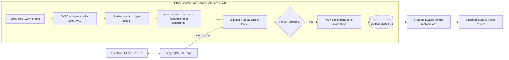

# Sauti Pesa

**An offline voice and text wallet for USDT, in Swahili and English.** You say or type *"Tuma USDT ishirini kwa
Amina"*. The AI runs **on your own device** with [QVAC](https://docs.qvac.tether.io): Whisper for speech and Qwen3-1.7B
for intent. Plain code then checks the payment, and [WDK](https://docs.wdk.tether.io) signs it **offline**.
Signed payments wait in an outbox until there is a network.

Track: **Agentic finance with WDK** · AI Yako: Own Your AI (Tether QVAC) · built by Swift Bot Labs

<p>
  
  &nbsp;
  
</p>

<details>
<summary>More screens (390 px): home, look-alike address blocked, message check, outbox</summary>
<p>
  
  
  
  
</p>
</details>

**Demo video (internet off): [sauti-pesa-demo.mp4](https://github.com/swiftbotlab/sauti-pesa/releases/download/v1.0/sauti-pesa-demo.mp4)** · captions ([.srt](https://github.com/swiftbotlab/sauti-pesa/releases/download/v1.0/sauti-pesa-demo.srt)) + English voice-over, 2:57.
Recorded before the final hardening pass. Since then `ops/ui.sh` prints a link that carries a per-launch key, and
the page needs that link; the payment flows in the video behave the same.

> [!IMPORTANT]
> Testnets only. There is no mainnet configuration in the code (`src/networks.js`). Use a fresh test wallet.

## Contents
- [Why](#why) · [What it does](#what-it-does) · [How it works](#how-it-works) · [Offline vs network](#offline-vs-network)
- [QVAC integration](#qvac-integration) · [WDK integration](#wdk-integration) · [Safety checks](#safety-checks) · [Security model](#security-model)
- [Run it](#run-it) · [Measurements](#measurements) · [Limitations](#limitations) · [Built during the event](#built-during-the-event-and-third-party-work)

## Why
Many people in East Africa now keep savings and receive remittances in USDT, next to M-Pesa. Three problems come up
again and again:

- **Connectivity is patchy and data costs money.** A wallet assistant that needs a cloud AI fails exactly when you
  are on a bus, in a market or at the end of your bundle.
- **Fake payment requests.** "You won a prize, pay the fee first", "I sent you money by mistake, send it back",
  "it's your boss, don't tell anyone". They come by SMS and WhatsApp, often in Swahili.
- **Crypto addresses are unreadable.** Address poisoning (a look-alike of an address you already pay) works because
  nobody compares 40 hex characters.

Sauti Pesa is for someone who speaks Swahili or English (or both in one sentence), pays family, a landlord or a
school in USDT, and wants a second pair of eyes that works offline and never sends their words or keys anywhere.

## What it does
- **Pay by voice or text, offline.** Speech to text and intent run on the device. Number words become digits
  in code ("arobaini na tano" = 45) before the model sees them.
- **A clear confirmation card:** amount, token, recipient name and short address, every check (passed, warning or
  blocked) and a **"needs network"** badge. Above 50 USDT the person **re-types the amount**. If the amount was not
  said, the app asks ("did you mean 15?") instead of guessing. Unclear names get a contact picker.
- **Offline signing with one-shot permission.** A WDK transaction policy lets the wallet sign exactly the payment the
  person confirmed, once. Signed transactions go to an **outbox**: queued, then broadcast, then confirmed, with an
  explorer link.
- **Check a message.** Paste an SMS or WhatsApp request and get a Swahili or English risk explanation, including
  look-alike address detection against your own contacts.
- **Status pill, always on screen:** "AI: on device · Network: OFF (verified)". It is backed by a live probe
  (interfaces, TCP, DNS), not a setting.
- **Re-sign** a queued payment whose nonce was used elsewhere (after checking on-chain that it was not mined).
- Mobile-first web UI (390 px and desktop), Swahili first, no external fonts or CDNs. Also a full CLI (`bin/sauti.mjs`).

## How it works



The **engine** (`src/engine.js`) keeps both models loaded inside the offline sandbox and answers a small JSON API on a
Unix socket. It refuses to start if the internet is reachable. A small **bridge** (`bin/bridge.mjs`, Node built-ins
only) serves the UI on `127.0.0.1` and forwards a fixed list of routes to the socket. The **sender**
(`bin/netsync.mjs`) is the only code with network access. It holds no keys. It syncs nonce, fees and balances, and
broadcasts the outbox in nonce order after decoding each raw transaction and comparing it with its record.

## Offline vs network

| Feature | Network? | Where |
|---|---|---|
| Speech to text (Whisper small + VAD) | **No** | `src/asr.js` in the offline sandbox |
| Intent understanding (Qwen3-1.7B) | **No** | `src/llm.js` in the offline sandbox |
| Safety checks, scam rules, look-alike addresses | **No** | `src/safety.js`, `src/scam.js`, `src/evmaddr.js`, `src/contacts.js` |
| Message check (scam explanation) | **No** | `src/safety.js` + `src/llm.js` |
| Signing (WDK + transaction policy) | **No** | `src/wallet.js` in the offline sandbox |
| Outbox, re-sign after a nonce clash | **No** | `src/queue.js`, `src/pipeline.js` |
| Web UI | **No** (127.0.0.1 only) | `ui/`, `bin/bridge.mjs` |
| Broadcast signed payments | Yes | `bin/netsync.mjs broadcast` (no keys) |
| Sync nonce, fee data, USDT and gas balances | Yes | `bin/netsync.mjs sync` (no keys) |
| First-time model download | Yes, once | `scripts/fetch_models.sh` (curl + sha256 only) |
| Installing npm packages | Yes, once | `ops/sandbox.sh setup npm ci` (install scripts off) |

After one sync, the app can queue many payments offline. Fees use the cached fee data with 100% headroom (or a safe
testnet default), and nonces are assigned locally.

## QVAC integration

| Item | Value |
|---|---|
| SDK | `@qvac/sdk` **0.22.0** (exact pin, lockfile committed) |
| Speech to text | Whisper small, q8_0 (`WHISPER_SMALL_Q8_0`, 264 MB), engine `whispercpp-transcription`, greedy, temperature 0, contact names as the initial prompt |
| Voice activity | Silero VAD 5.1.2 (`VAD_SILERO_5_1_2`, 0.9 MB), passed as `vadModelSrc` |
| Language model | Qwen3-1.7B Q4_0 (`QWEN3_1_7B_INST_Q4`, 1.06 GB), engine `llamacpp-completion` |
| Structured output | `completion({ responseFormat: { type: 'json_schema', … } })` (QVAC turns it into a llama.cpp grammar), then every field is re-validated in code (`src/intent.js`) |
| Speed | QVAC `kvCache` keys (`sauti-intent-v1`, `sauti-scam-v1`) keep the fixed system + few-shot prefix: about 680 of 700 prompt tokens come from the cache |
| One Whisper instance | `loadModel({ modelId, modelConfig })` reload-config switches sw/en without a second copy in RAM |
| Model files | `models.json`: Hugging Face origin at the exact commit QVAC's registry pins, with QVAC's sha256. `scripts/fetch_models.sh` downloads with curl and checks size + sha256 |
| Licences | Qwen3-1.7B Apache-2.0 · Whisper MIT · Silero VAD MIT |

Files that call QVAC: [`src/asr.js`](src/asr.js) (`loadModel`, `transcribe`, `unloadModel`),
[`src/llm.js`](src/llm.js) (`loadModel`, `completion`, `deleteCache`, `unloadModel`),
[`src/engine.js`](src/engine.js) (resident models, warm-up, `close`), [`bin/sauti.mjs`](bin/sauti.mjs) (CLI).

Rejected after measuring: Whisper base (fast, but it mangles Swahili names) and Qwen3.5-2B (about 5.2 s per request,
2.9 GB, and 11/12 instead of 12/12 on our tuned intent set). Whisper large-v3-turbo q5_0 is available in the CLI as
`say --accurate` (better Swahili, but 6-10 s per clip on this CPU).

## WDK integration
- `@tetherto/wdk` **1.0.0-beta.22** + `@tetherto/wdk-wallet-evm` **1.0.0-beta.24** ([`src/wallet.js`](src/wallet.js)).
- The seed is generated by WDK and stored only in `private/wallet.json` (mode 0600; the code refuses to read it if
  group or world can). It is never printed and never crosses the bridge.
- **Transaction policy:** before each signature, the code registers a WDK policy that allows exactly one
  `signTransaction`: this token, this recipient, this amount, this chain id, and gas × max fee under a cap. Any other
  transaction, message signing or a second signature is refused by WDK itself (`PolicyViolationError`). Tests cover
  both directions: the confirmed transfer signs, and a changed amount, recipient, chain or fee is refused.
- Signing is offline (`WalletManagerEvm` account, `signTransaction` with a locally assigned nonce and cached fees).
  Broadcasting happens later, in a different process.
- ERC-20 test USDT: on Sepolia the 6-decimal test USDT `0xaA8E23Fb1079EA71e0a56F48a2aA51851D8433D0` that the WDK
  docs list for testnets; on the local devnet our `contracts/MockUSDT.sol`.

## Safety checks
All in plain code, in [`src/safety.js`](src/safety.js), [`src/contacts.js`](src/contacts.js),
[`src/evmaddr.js`](src/evmaddr.js) and [`src/scam.js`](src/scam.js). The model proposes, the code decides.

- **Addresses never come from the model.** They are copied from the person's own text with a regex and checked
  (EIP-55 checksum, zero address, the token contract itself).
- **The amount must be in the person's words.** If the model "hears" an amount nobody said, the payment is blocked,
  and the app asks for the amount. Digits inside an address never count as said, and neither does a lone "one"
  ("the one from church").
- **The recipient must be in the person's words** (by name or relation, or picked by the person). In our Swahili
  test set the model once returned a saved contact for a request that named no one. Only a contact's own name words
  count, never a relation or title word, and they must point back to that one contact: "shangazi Wanjiku" (an aunt)
  does not name the landlord "Amina Wanjiku".
- **Contacts:** name, relation ("kaka yangu" = my brother) and speech-recognition glue ("kuwanjiru"). Near misses
  and family names alone give "did you mean", never an automatic pick.
- **Look-alike addresses** (same first and last characters as an address you already pay) are blocked; weaker
  similarities get a warning.
- **Shillings and M-Pesa** in the words block the payment, even if the model says USDT, and even if "USDT" appears
  somewhere: only an explicit USDT amount next to a shilling comparison is accepted, and then only that amount.
  "Dola"/"dollar" is read as USDT on purpose and shown as such.
- **Limits:** per payment, per day and for a first payment to a new address. The cached balance is checked, and the
  amount must be re-typed above 50 USDT.
- **Scam rules** (Swahili + English): pay-to-unlock, prizes with a fee, "sent by mistake", claimed relative/boss/agent,
  secrecy, urgency, seed or PIN requests, remote-access apps, investment promises. The model's opinion can only
  **add** a low-level hint, never lower a risk. High risk needs a rule or address evidence.

## Security model
- **Sandbox** ([`ops/sandbox.sh`](ops/sandbox.sh), bubblewrap). Only the project directory is visible, and it is
  **read-only in every mode**: code inside a sandbox can never change files that run on the host. `offline` mode
  (all AI, all signing): own empty network namespace, writable `private/ queue/ tmp/ home/`. `devnet`: a private
  loopback for the local chain, writable `queue/devnet/` only. `online`: host network for `bin/netsync.mjs` only,
  writable `queue/<network>/` only. `setup`: only `npm ci` (install scripts forced off) and `curl`. Every mode
  except `offline` sees `private/` and `tmp/` as empty. Cleared environment, project-local HOME.
  Each guard is tested with a positive control (`test/sandbox.sh`).
- **Isolation proof.** `ops/sandbox_probe.mjs --port N` run on the host (positive control) and in each sandbox mode
  (N: any service listening on the host's 127.0.0.1; here a throwaway listener):

  | Probe | Host | `offline` | `devnet` | `online` |
  |---|---|---|---|---|
  | Entries in the real home directory | 34 | 1 (only the path to the project) | 1 | 1 |
  | `~/.ssh` visible | true | false | false | false |
  | Local service on the host's 127.0.0.1 reachable | true | false | false | true |
  | TCP to 1.1.1.1:443 / DNS resolves | true / true | false / false | false / false | true / true |
  | HTTPS to npm / Sepolia RPC | 200 / 200 | fail / fail | fail / fail | 200 / 200 |
  | Project code (`bin/`, `ops/`) or `.git` writable | true | false | false | false |
  | Test wallets under `tmp/` visible | yes | yes (the signer) | none | none |
  | Environment variables | 49 | 7 | 8 | 8 |

- The engine runs its own check at start (interfaces, a TCP connect, a DNS lookup) and refuses to start when the
  internet is reachable or when it is not in the offline sandbox. The UI shows the same live proof.
- **Bridge:** binds `127.0.0.1` only. Every API call needs this launch's random key: `ops/ui.sh` prints a link with
  the key in its `#fragment`, the page sends it in a header, and the bridge compares it in constant time, so other
  users or programs on the machine cannot use the wallet. It also checks the Host header (against DNS rebinding)
  and the Origin; the custom header means cross-site pages need a CORS preflight, which is never answered. It serves a fixed file list,
  forwards a fixed route list, caps sizes (16 KB JSON, 5 MB audio) and handles one request at a time. A strict CSP
  is set (`default-src 'none'`, no inline scripts).
- **Broadcasting:** a payment is offered for re-signing only when the chain proves it can no longer be mined (no
  receipt, mined nonce past it, hash unknown to the node), so a payment waiting in the mempool is never paid twice.
  Network errors leave a payment queued and inside the daily limit; runs from the CLI and the UI take a lock.
- **Untrusted input:** text, audio and model output are size-capped and cleaned (control, zero-width and bidi
  characters). Audio is checked by content (RIFF/WAVE, 16-bit PCM, ≤ 30 s). Uploads go to a 0700 temp dir and are
  deleted after use. Model output is capped at 2 KB and validated field by field.
- **Supply chain:** exact pins and lockfile; tarballs checked against registry integrity; registry signatures
  verified for all 289 lockfile entries (`scripts/verify_sigs.mjs`); no package in the tree has install scripts.
  Models are sha256-checked. Details: [`SECURITY.md`](SECURITY.md).

## Run it

**Requirements:** Linux (tested on Ubuntu 26.04, aarch64, 6 CPU cores, 8 GB RAM, no GPU), Node.js ≥ 22.17
(tested 22.22.1), bubblewrap (tested 0.11.1), curl, python3, about 4 GB of disk (1.3 GB models; QVAC's native
packages are about 1.6 GB of the 2.6 GB `node_modules`). For the local chain: Foundry's
[anvil](https://getfoundry.sh) (tested 1.8.5). For the UI: any current browser.

```bash
git clone https://github.com/swiftbotlab/sauti-pesa.git && cd sauti-pesa
ops/sandbox.sh setup npm ci                                   # exact pins, install scripts off
scripts/fetch_models.sh QWEN3_1_7B_INST_Q4 WHISPER_SMALL_Q8_0 VAD_SILERO_5_1_2   # ~1.3 GB, sha256-checked

ops/sandbox.sh offline node bin/sauti.mjs wallet init        # new TEST wallet; the seed stays in private/
ops/sandbox.sh offline node bin/sauti.mjs contacts demo      # 5 demo contacts (Amina, Juma, Wanjiru, Otieno, Mama Neema)
ops/devnet.sh devnet-setup                                   # local chain: test USDT + gas, no faucet needed
ops/ui.sh                                                    # then open the link it prints
```

If `anvil` is not on your `PATH`, set `SAUTI_ANVIL=/path/to/anvil` (or put that line in `ops/local.env`, chmod 600).
`ops/ui.sh` prints `http://127.0.0.1:8787/#k=...`: the part after `#k=` is a random key for this session (new at
every start); the page needs it, so open that exact link. The engine needs 15-25 s to load both models and warm them
up. Then try:
- tap the mic and say *"Tuma USDT ishirini kwa Amina"*, or type *"Send 40 USDT to Otieno for rent"*;
- paste an address that looks like Amina's: `data/demo-attack.json` has one;
- **Kagua / Check**: tap the "Prize" example;
- **Foleni / Outbox**: "Go online and send" broadcasts on the local devnet.

<details>
<summary>CLI instead of the UI</summary>

```bash
ops/sandbox.sh offline node bin/sauti.mjs ask "Tuma USDT ishirini kwa Amina" --require-offline
ops/sandbox.sh offline node bin/sauti.mjs say test/audio/sw_juma_15.wav --lang sw
ops/sandbox.sh offline node bin/sauti.mjs check "Umeshinda zawadi! Lipa ada ya usajili..."
ops/sandbox.sh offline node bin/sauti.mjs queue
ops/sandbox.sh offline node bin/sauti.mjs resign <outbox-id> --yes      # after a nonce clash
ops/devnet.sh broadcast
```
</details>

<details>
<summary>Ethereum Sepolia instead of the local devnet</summary>

1. Get Sepolia ETH for gas from any faucet, and test USDT `0xaA8E23Fb1079EA71e0a56F48a2aA51851D8433D0` from the
   Aave v3 testnet faucet (`0xC959483DBa39aa9E78757139af0e9a2EDEb3f42D`, `mint(token, to, amount)`).
2. `ops/sandbox.sh online node bin/netsync.mjs sync --network sepolia` (nonce, fees, balances; no keys).
3. In the UI, switch the network to Sepolia, pay offline, then "Go online and send" in the outbox, or run
   `ops/sandbox.sh online node bin/netsync.mjs broadcast --network sepolia`.
</details>

**Reproduce with the internet disconnected.** The sandbox already gives the AI and the wallet no network, but you
can also unplug the whole machine:
1. With the internet on, run only the two setup lines (`npm ci` and `fetch_models.sh`).
2. Disconnect (Wi-Fi off, cable out). Check: `curl -sS --head -m 5 https://huggingface.co` fails.
3. Run everything else above: `wallet init`, `contacts demo`, `devnet-setup` (the local chain needs no internet),
   `ops/ui.sh`, then pay by voice and text, run the checks, and broadcast to the local devnet. The status pill and
   `ops/sandbox.sh offline node ops/sandbox_probe.mjs` show the network state.
4. Only the Sepolia path (sync and broadcast to a public testnet) needs the internet back.

**Tests:**

```bash
ops/sandbox.sh offline node --test test/*.test.js   # 58 unit tests, no model (3 need the private test set, else skipped)
test/sandbox.sh          # 22 sandbox checks with positive controls (read-only code, masks, lock, local.env)
test/e2e_offline.sh      # CLI, internet off: Swahili text + English voice payments, blocks, devnet broadcast
test/e2e_ui.sh           # engine + bridge API, 81 checks, incl. the UI key and re-sign after a nonce clash
scripts/eval_sw_requests.sh  # the commissioned Swahili test set (private: skipped when absent, see below)
# Judges: reproduce our checks on a PUBLIC, redistributable Swahili set (10 genuine + 3 scam) shipped in this repo:
SAUTI_EVAL_SET=test/data/public/sw_requests_public.md SAUTI_EVAL_LABELS=test/data/public/sw_requests_public.labels.json scripts/eval_sw_requests.sh
scripts/bench_latency.sh # before/after latency
```

## Measurements
Device: Linux aarch64, 6 cores, 7.9 GB RAM, **CPU only (no GPU)**. The machine is shared with other work. The
table shows medians from `scripts/bench_latency.sh`; when the CPU was busy we saw requests take 2-5x longer. The demo
video shows real, unedited timings from such a shared machine.

**Latency, one request (wall clock):**

| Path | Before: one process per request (models load every time) | After: resident engine, KV-cached prompt |
|---|---|---|
| Voice (3.6-4.3 s clip) to checked payment | 9.2-10.5 s | **2.6 s** median (3.8 s max); ASR 1.35 s median |
| Text to checked payment | 6.2-6.5 s | **1.0 s** median (2.3 s max); LLM 1.0 s median |
| Engine start (once) | none | 15-25 s to ready (both models load, one warm-up transcription, prompt cache) |

About 680 of the ~700 prompt tokens are served from QVAC's KV cache (median; `scripts/bench_engine.mjs`).

**Memory:** resident engine about 2.2-2.8 GB RSS (both models loaded, including memory-mapped weights). The CLI loads one model at a time: peak
~2.6 GB. Whisper alone ~1.2 GB with two language instances; one instance with reload-config in the engine.

**Accuracy:**
- Voice to decision, 6 synthetic clips (sw-KE, sw-TZ, en-KE neural voices): **6/6** (5 payments with the right
  amount and payee; the scam clip blocked).
- Intent: tuned set 12/12; held-out set **11/12**. In every miss, the code blocked the payment instead of sending a
  wrong amount.
- **Commissioned Swahili test set**: 30 everyday requests (16 standard Swahili, 6 Sheng, 8 code-switched with
  English) + 5 scams, text only, written for us by an independent Swahili speaker. The set itself is private (we
  do not have the rights to redistribute it) and is not in this repository; `scripts/eval_sw_requests.sh` runs when
  it is placed in `test/data/private/`.

  | Measure | Result |
  |---|---|
  | USDT requests (7): action, amount, token and recipient all right | **7/7** |
  | Amount read right, all 30 (amount as said, any currency) | **28/30** (standard 16/16, code-switched 8/8, Sheng 4/6: *thao moja* read as 1, *soo tano* as 5) |
  | Named third-party recipient extracted | **11/11** |
  | Payments that reached "confirm" with a wrong amount or person | **0** |
  | Shilling requests that could be confirmed as USDT | **0/16** |
  | Message check, everyday requests rated high risk | 1/30 before → **0/30** after |
  | Message check, everyday requests rated medium | 10/30 before → **1/30** after |
  | Message check, scams rated high | 1/5 before (4/5 at least medium) → **5/5** after |

  "After" includes rules we added from this set, so the after numbers for scams are **not held out**. The set also
  led to two new checks: the recipient must be named in the person's words, and shillings/M-Pesa words block. Measured
  outcomes (no text from the set): `test/data/eval_sw_requests_results_before.json` and
  `test/data/eval_sw_requests_results.json`.

**On-chain:** every payment below was parsed by the on-device AI, checked in code, signed offline by WDK and later
broadcast by the keyless sender on Ethereum Sepolia (all status 1). Wallet
[`0x23A5…56Cc`](https://eth-sepolia.blockscout.com/address/0x23A5e0dC05105FEE4Be4900e26Ec5f10Eb5656Cc) (test only).

| Nonce | Payment | Signed offline from | Block | Transaction |
|---|---|---|---|---|
| 3 | 20 test USDT to Amina | first test (CLI) | 11995524 | [`0x5d2e058b…7a0206`](https://eth-sepolia.blockscout.com/tx/0x5d2e058b3960d14b0fe23784bcc200c6d8df21a3760852f76e7cb5a27e7a0206) |
| 4 | 15 test USDT to Juma | first demo recording | 11996109 | [`0xa7503715…bc0dd5`](https://eth-sepolia.blockscout.com/tx/0xa75037152c41c141e98d9fc2971d0ba95929dd5067a1ac80b74ce62025bc0dd5) |
| 5 | 40 test USDT to Otieno | first demo recording | 11996110 | [`0x598a2597…e9748a`](https://eth-sepolia.blockscout.com/tx/0x598a259769bb05fc8a8da62177cd9bc52955e0e7e371e50ac008ab2f67e9748a) |
| 6 | 60 test USDT to Wanjiru | first demo recording | 11996111 | [`0x562504ea…58e0cb`](https://eth-sepolia.blockscout.com/tx/0x562504ea9b9912e32a49d2a00d2dcaa539b5278b1138198b1c3b0ba64a58e0cb) |
| 7 | 15 test USDT to Juma | demo video | 11996338 | [`0x563a10c1…f0d29c`](https://eth-sepolia.blockscout.com/tx/0x563a10c1f4948329acfa1850bea2af8535c74a24c2c7dcaa20e4acefa3f0d29c) |
| 8 | 40 test USDT to Otieno | demo video | 11996339 | [`0x56b1aa5d…b3cf25`](https://eth-sepolia.blockscout.com/tx/0x56b1aa5d35e6deee57bbd91f44e9d45d88db9f88f108bda42b24c7c0c4b3cf25) |
| 9 | 60 test USDT to Wanjiru | demo video | 11996340 | [`0xeb007c47…9bc91e`](https://eth-sepolia.blockscout.com/tx/0xeb007c4773e942ce454e8d9b30a5c2805fd10716ea0369db3e229437739bc91e) |

## Limitations
- **Audio is synthetic.** The voice clips are neural TTS voices; real speakers, background noise and heavy
  code-switching are not tested yet. Whisper small makes Swahili mistakes; the code catches many of them (amount and
  recipient must match the words) but it can ask more often than it should.
- **Small-model Swahili numbers.** Sheng amounts like *thao* (thousand) and *soo* (hundred) are not normalized yet.
- The 1.7B model's own scam opinion is noisy. That is why it can only add a low-level hint.
- Message-check language detection is a keyword heuristic.
- The web UI runs on a laptop or desktop (Linux). A phone build (Bare/Pear runtime) is not done; the UI is mobile-first
  so it can be wrapped later.
- The `online` sender shares the host's network namespace (it runs only our own sender code; see
  [`SECURITY.md`](SECURITY.md)).
- Testnets only. Not audited.

## Built during the event and third-party work
Everything in this repository was written for AI Yako by Swift Bot Labs during the event (from 2026-10-26), except the
third-party packages, models and the commissioned test set listed in [`THIRD_PARTY.md`](THIRD_PARTY.md). Licence:
Apache-2.0 ([`LICENSE`](LICENSE)).
